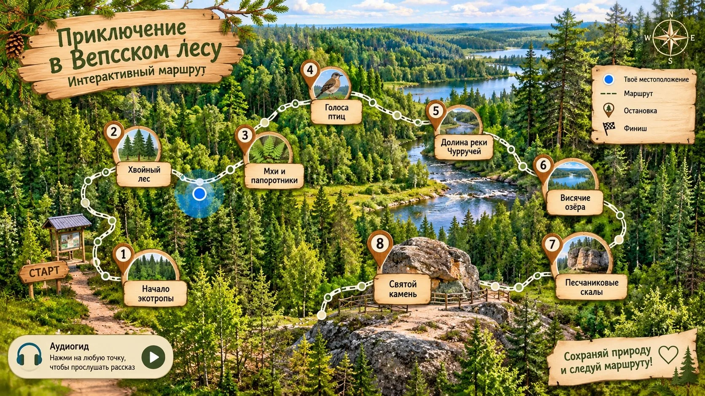
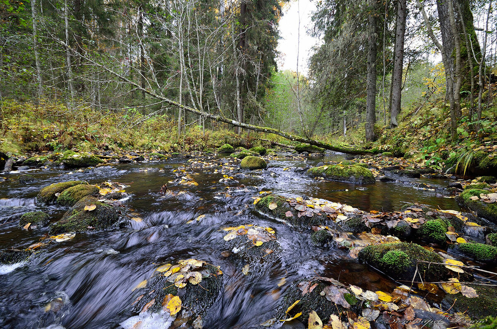
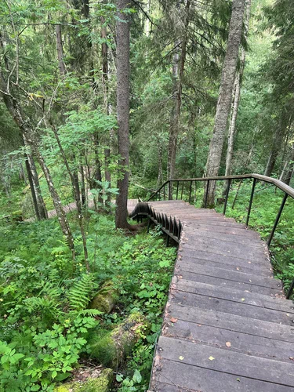
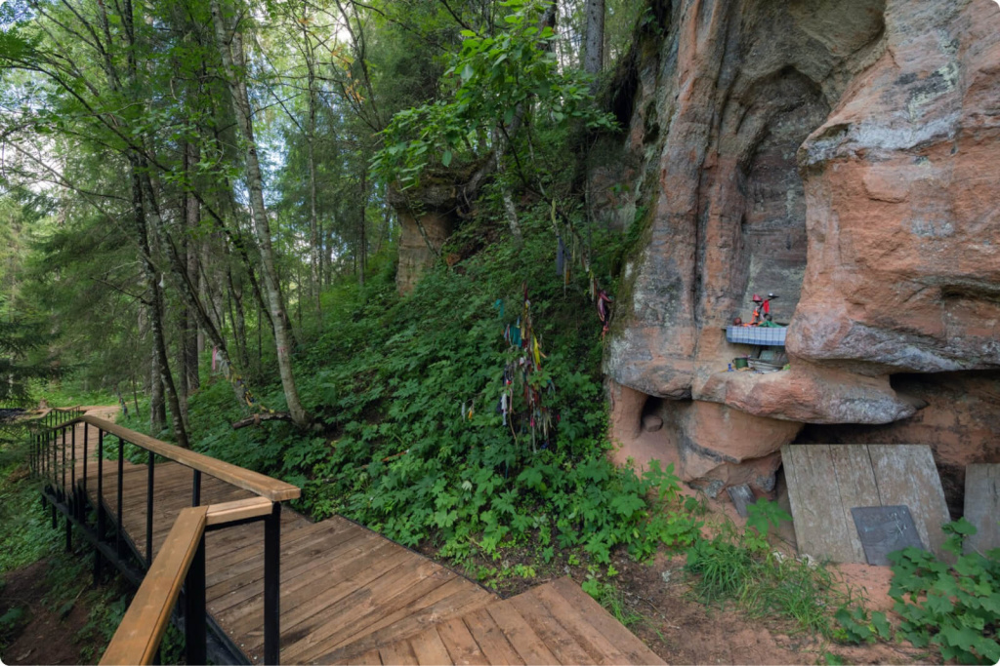
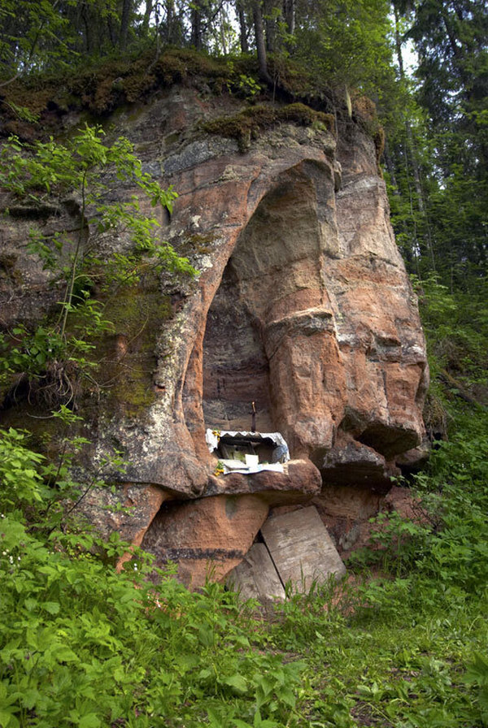
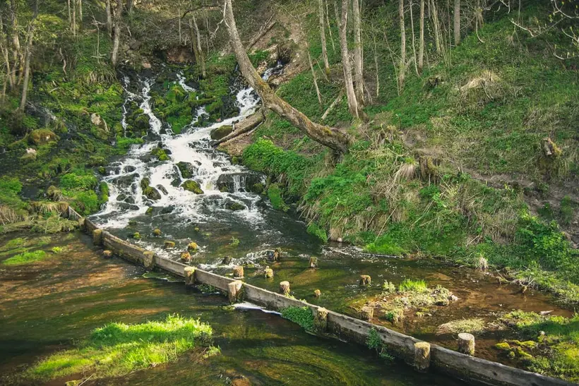

<html>
<head>
<title>"Эко-тропа Святой камень </title>
</head>
<body bgcolor="lightblue">

 

<b>
<h1>                            Экотропа Святой камень в Ленинградской области.
 

</b>
</h1> 
<h4>Экологическая тропа открыта для посещения с мая по октябрь, 
<h4>или зимой — после образования устойчивого льда на реке Оять. 
<h4>Также можно воспользоваться индивидуальными плавсредствами (сапы и резиновые лодки).
<h4>Экологическая тропа проходит по краю резервата "Висячие озёра", в долине реки Чурручей, и ведёт к месту поклонения нескольких 

<h4>поколений вепсов - "Святому камню". Он является обнажением коренных горных пород, сложен песчаником. 
<h4>Вепсы верили, что их всюду окружает "живая сознательная сила", к этой силе была выработана система отношений в виде различных 

<h4>обрядов, примет, оберегов и т.д. Люди и сейчас продолжают ходить к камню, оставляют что-либо из своих вещей в дар. 
<h4>Почитание "Святого камня" известно с конца XIX века.  
<h4>Крутой спуск к "Святому камню" обоудован лестницей.
<h4>Резерваты отличаются более строгим режимом охраны. Создан для сохранения уникального ландшафта "висячих" по отношению к долине 

<h4>реки Оять озёр, сохранения биологического разнообразия флоры и фауны, а также для организации научного туризма и экологического 

<h4>просвещения.
</h4>

 
<a href="https://yandex.ru/maps/?um=constructor

%3A1a0ce9768030b216364f20d972220f94b9d8c8cdacdf14e7ce67fcd8ce540a22&source=constructorLink"> <b>  Переходи на 
интерактивную карту!</a></b>
 

<h2>Добро пожаловать!
 

 

 

<a href="https://cms.izi.travel/99100/tours/1870387/map?
sw=lat_60.490196322191935_lng_34.49762467612844&ne=lat_60.51268033176601_lng_34.5794213222466&zoom=14">
<b>  Переходи на аудио гид!</a></b>
 
</body>
</html>
